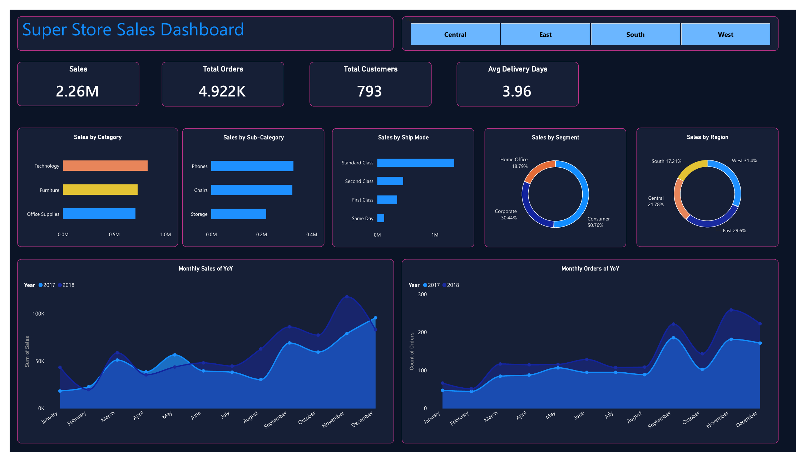

# Super Store Sales Dashboard (Power BI)

An interactive one-page Power BI dashboard built on the Superstore Sales dataset: 9,800 order lines, 4,922 orders and 793 customers, January 2015 to December 2018.

A PDF export of the dashboard is in [`dashboard.pdf`](dashboard.pdf).

## What the dashboard shows

**KPI cards**
- Total Sales: 2.26M
- Total Orders: 4,922
- Total Customers: 793
- Avg Delivery Days: 3.96

**Charts**
- Sales by Category
- Sales by Sub-Category (top 3)
- Sales by Ship Mode
- Sales by Segment (donut)
- Sales by Region (donut)
- Monthly Sales of YoY (2017 vs 2018)
- Monthly Orders of YoY (2017 vs 2018)

**Interactivity:** Region buttons filter every card and chart on the page.

## Key insights

- **Technology** is the largest category, with 36.59% of sales.
- **West** (31.40%) and **East** (29.60%) bring over 60% of sales; South is the smallest region (17.21%).
- Sales peak towards the end of the year: **November, December and September** are the strongest months on average.
- Standard Class shipping takes about 5 days on average, Same Day is almost instant.

## How it was built

1. Cleaned the CSV in Excel (date formats, encoding issues).
2. Loaded it into Power BI Desktop and set the dates to the dd/mm/yyyy format.
3. Counted orders and customers with **Distinct Count**, because each row is one product line, not one order.
4. Created a **DAX measure** for average delivery days (ship date minus order date).
5. Built the cards, charts and Region slicer, and styled them with a dark theme (custom background, borders, colours and fonts).

## Related project

The same data analysed with SQL (10 queries using JOINs, CTEs and window functions):
[superstore-sql-analysis](https://github.com/md-zafarali/superstore-sql-analysis)

## Tools

Power BI Desktop · DAX · Excel

## Data

[Superstore Sales Dataset](https://www.kaggle.com/datasets/rohitsahoo/sales-forecasting) (`train.csv`) by rohitsahoo on Kaggle, licensed GPL 2. The raw data and the `.pbix` file are not included in this repo; only the dashboard PDF and screenshot are shared.

The dataset has no Profit or Quantity column, so the analysis is based on Sales.
